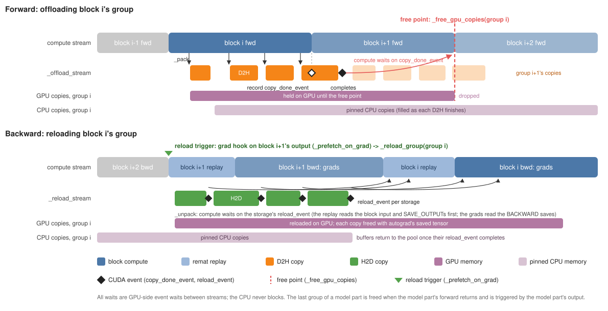

# Activation offloading

Activation offloading reduces the peak memory of training by moving
activations from GPU HBM to CPU DRAM during forward and copying them back
during backward. The technique is well known; this doc describes how
TorchTitan implements it (`activation_offload.py`), how it composes with remat
([REMAT.md](REMAT.md)), FSDP2 and pipeline parallelism, and what it costs.

## What do we offload, and can the user control it?

We offload **saved tensors**: tensors produced in forward that autograd keeps
for the gradient computation in backward. Saved-tensor hooks (a `pack` hook
called when a tensor is saved, an `unpack` hook called when backward reads it)
see exactly these tensors, so the offloader is built on them.

The offloader installs `torch_remat.saved_tensors_hooks` for the forward of
each transformer block. This works with and without remat:

- **With remat**, the hooks see only what remat keeps for backward; tensors
  remat recomputes are never packed, so they are never offloaded. Remat also
  tells the hook *why* each tensor is kept (`SavedTensorInfo.kind`) and which
  save region kept it (`SavedTensorInfo.region`):
  - `CHECKPOINT_INPUT`: the block's input, which the replay in backward starts
    from;
  - `SAVE_OUTPUT`: a save region's output, which the replay reuses instead of
    recomputing the region;
  - `BACKWARD`: tensors a save region's ops keep for their own gradient.
- **Without remat** (offload instead of recompute), every autograd save of the
  block is packed, with no kind or region.

The user selects what to offload with `ActivationOffloadConfig`, set as
`TrainingEngine.Config.activation_offload` (independent of
`activation_remat`):

| Field | Default | Selects |
|---|---|---|
| `offload_block_input` | `True` | each block's input hidden state (`CHECKPOINT_INPUT` that requires grad); under full remat this is the whole stash |
| `offload_regions` | `[]` | glob patterns over save-region names, e.g. `["attention.*"]`; `["*"]` = everything save regions keep |
| `offload_saves_outside_regions` | `False` | saves with no region, i.e. every save when the block is not remat-checkpointed |
| `min_bytes` | 1 MiB | smaller storages stay on GPU |
| `skip_last_layers` | 1 | the last N blocks of each model part are not offloaded |

Some tensors are never offloaded, whatever the config: parameters (the module
holds them, so offloading frees nothing, and under FSDP2 the copy would race
with resharding), storages shared with the model part's own input (the caller,
e.g. a pipeline stage, holds them), and non-plain-CUDA tensors.

## Is this a memory/performance trade-off?

Yes, in both directions, and the knob is *time*: how long a copy has to
overlap with compute before something has to wait for it.

- **Forward: the free point.** Queuing a copy to the CPU does not save memory;
  dropping the GPU copy does. The GPU copy can only be dropped once the copy
  has finished, so the offloader picks a **free point** at which the compute
  stream waits for the group's copies and then drops the GPU copies. Peak
  memory is set by how late the free point is; if the copies have not finished
  by then, compute stalls at the free point.
- **Backward: the reload trigger.** A tensor must be back on the GPU before the
  gradient computation reads it, so the offloader starts its copy ahead of time
  at a **reload trigger**. If the copy has not finished when `unpack` needs the
  tensor, compute stalls there.

All waits are GPU-side event waits between streams; the CPU never blocks.

## Terms (names as in the code)

| Term | Code | Meaning |
|---|---|---|
| offload group | `_OffloadGroup` | the storages packed during one call of one transformer block; the unit that is freed and reloaded together |
| pack | `_pack` | selects a saved tensor and queues its D2H copy on `_offload_stream` |
| copy-done event | `group.copy_done_event` | CUDA event recorded on the offload stream when the block's forward returns; completes when all of the group's D2H copies are done |
| free point | `_free_gpu_copies` | end of the *next* block's forward: the compute stream waits on `copy_done_event`, then the group's GPU copies are dropped |
| reload trigger | `_prefetch_on_grad` -> `_reload_group` | a gradient hook on block `i + 1`'s output; when that gradient is ready, it queues the H2D copies of group `i` on `_reload_stream` |
| reload event | `storage.reload_event` | CUDA event recorded after one storage's H2D copy |
| unpack | `_unpack` | the compute stream waits on the storage's `reload_event` and the saved tensor is rebuilt from the reloaded copy |

The timeline below follows block `i`'s offload group through forward and
backward:

## Forward flow

For block `i`:

1. When block `i`'s forward starts, the offloader opens its offload group and
   enters the saved-tensor hooks.
2. `pack` runs for each saved tensor. A selected tensor's D2H copy is queued
   on the offload stream right away; the offload stream first waits for the
   compute stream, so the copy starts once the tensor has been produced.
3. When block `i`'s forward returns, `copy_done_event` is recorded on the
   offload stream.
4. Block `i + 1`'s forward runs; group `i`'s copies overlap with it.
5. When block `i + 1`'s forward returns, the free point for group `i` runs:
   the compute stream waits on group `i`'s `copy_done_event` and its GPU copies
   are dropped. The last group of a model part is freed when the model part's
   forward returns.

Notes:

- Copies are per **storage**, not per tensor and not packed into one buffer:
  a storage is copied once even when several saved tensors view it (e.g. the
  q, k and v slices of a fused QKV output), and each saved tensor is rebuilt
  from the reloaded storage.
- At most two groups' worth of offloaded activations are on the GPU at once
  (the block running and the one before it). The free point waits only on its
  own group's event, so later groups' copies never delay compute.
- If a group's volume is too large to copy during the next block's forward,
  the free point stalls compute. That is the forward side of the trade-off.

## Backward flow

1. Block `i + 1`'s output gradient becomes ready, just before block `i + 1`'s
   backward. Its reload trigger runs `_reload_group(group i)`: for each
   storage, it allocates the GPU copy on the compute stream (so it is freed in
   compute-stream order), queues the H2D copy on the reload stream and records
   the storage's `reload_event`. The model part's output triggers the last
   group.
2. Block `i + 1`'s backward runs (under remat: replay, then gradients); group
   `i`'s reloads overlap with it.
3. Block `i`'s backward calls `unpack` for each saved tensor it reads; the
   compute stream waits on that storage's `reload_event`. A storage nothing
   prefetched is reloaded on demand (counted in `num_on_demand_reloads`).
4. Each reloaded copy is freed together with autograd's saved tensor, as soon
   as backward is done with it.

Notes:

- Reloads are per group. They get block `i + 1`'s whole backward to overlap
  with, which is roughly 2x the forward (more with remat's replay), so a
  volume that does not stall the forward rarely stalls the backward.
- Under remat, block `i`'s backward reads its tensors in this order: the block
  input and the `SAVE_OUTPUT`s when the replay starts, then the `BACKWARD`
  saves during the gradient computation. Reloads are queued in pack order,
  which already puts the block input and region outputs first. Queuing
  `BACKWARD` saves last would help only when reloads barely finish in time
  (TODO).

## What happens with the last layers?

The last block of the model has almost no time to overlap with: only the
loss computation runs between its forward and its backward. Offloading it
would cost two transfers, D2H and H2D, and free its memory for almost no
time, and the free point and the reload would both likely stall compute. So
`skip_last_layers` (default 1) leaves the last N blocks of each model part on
the GPU; their blocks are not hooked at all.

## Granularity: why one transformer block per group?

An offload group is one transformer block call: the same unit remat
checkpoints.

Finer groups (e.g. attention and MLP separately) would help the forward: a
group's GPU copies are held until the end of the next group, so with
sub-block groups at most about two sub-blocks' worth of offloaded
activations sit on the GPU instead of two blocks' worth, and memory is
released earlier in the forward. Under block remat that is the only gain:

- **No backward savings.** Remat replays the whole block at the start of its
  backward, so every group of the block must be reloaded at once and the
  backward peak does not change. The first sub-group's reload also loses its
  lookahead: its trigger fires just as the replay needs it.
- **The block input is missed.** Remat packs it when the checkpoint is
  entered, before any sub-block group opens, so it is never offloaded.
- **Deferred saves cross groups.** Remat defers a region output's save to its
  first consumer, which can run after the producing group's free point.

Finer offload groups make sense only together with finer remat checkpoints
(Megatron recomputes and offloads at submodule granularity).

## Does it compose with FSDP?

Yes. The design borrows FSDP2's structure for overlapping transfers with
compute: per-block hooks, a dedicated stream per transfer direction,
event-based waits between streams, and prefetching one block ahead in
backward from a hook on the block's output gradient.

**Why not a hook inside FSDP2?** We considered it and rejected it for two
reasons:

1. Offload should also work without FSDP. This is a weak argument: a run
   without FSDP sharding could still use the FSDP codebase with degree 1.
2. The main reason: offload must understand torch_remat (what remat saves vs
   recomputes, save-region names, `is_recomputing()`). torch_remat is a
   separate package, and FSDP2 lives in pytorch/pytorch; teaching FSDP2
   about remat concepts such as save regions does not belong there.

**Hook order.** Both are forward hooks on the same transformer blocks. FSDP2
is applied in `parallelize`; offload is applied afterwards by
`TrainingEngine`, so in each pair FSDP2's hook runs first:

| When | FSDP2 | then offload |
|---|---|---|
| block pre-forward | unshard parameters | open the offload group, enter the saved-tensor hooks |
| block post-forward | reshard, register its pre-backward hook on the output | close the group, free the previous group, register the reload trigger on the output |
| block output gradient ready | unshard this block, prefetch the previous block's parameters | reload trigger: reload the previous block's group |

**FSDP CPU parameter offload.** With `CPUOffloadPolicy`, FSDP2 also copies
each block's parameter shard host-to-device, in forward and again in
backward, so both runtimes compete for the H2D direction of the CPU-GPU link
in backward. With `reload_on_fsdp_copy_in_stream=True`, activation reloads are
issued on FSDP2's all-gather copy-in stream, the stream FSDP2 issues those
parameter copies on. The two kinds of H2D copy then never run concurrently,
and they run in a defined order: because of the hook order above, block
`i - 1`'s parameters are queued before block `i - 1`'s activations. D2H copies
keep separate streams (FSDP2's gradient D2H runs on its reduce-scatter
stream, behind NCCL). The stream is reached through FSDP2's private comm
context; a public accessor would be the only upstream change.

## Does it compose with pipeline parallelism?

Yes, and basic PP needs no changes: each pipeline stage is a model part with
its own offloader, and groups are per block call, so several microbatches can
be in flight per stage (each forward's groups are kept alive by its autograd
graph).

The catch is each stage's last block. Without PP, only the model's last block
is caught between its forward and its backward. With PP, every stage is: for
a given microbatch, the stage's last block has little time to offload before
the forward leaves the stage, and its backward starts as soon as the gradient
arrives from the next stage, leaving no time to reload. `skip_last_layers`
avoids the problem by keeping each stage's last block on GPU, at the cost of
one block of activations per microbatch in flight on every stage.

To offload those blocks too, the schedule can take over the stage boundary,
the way it drives FSDP's UNSHARD/RESHARD actions today:

- `defer_to_schedule()`: the schedule, not the model part's hooks, decides
  when each microbatch's last group is freed and reloaded;
- `wait_offload()`: the schedule calls it one action after a forward; it
  frees that forward's last group, whose copies had the action's compute to
  finish;
- `reload_next_backward(num_groups=1)`: the schedule calls it ahead of a
  backward; it queues the reload of the last `num_groups` groups of the
  oldest microbatch whose backward has not run. `num_groups` equal to the
  number of blocks reloads the whole stage, which pays off only for stages of
  one or two blocks.

Inside the stage, gradient hooks still prefetch one block ahead, and the
model part's output keeps its reload trigger as a fallback. The offloader
side is implemented and unit-tested with the calls made in 1F1B order. The
PyTorch schedule actions that would make these calls are not part of this
change.

## Pinned host memory and CUDA graphs

**Why a buffer pool.** An offloaded tensor needs a CPU buffer, and it must be
pinned (page-locked) for the copy to run asynchronously. The simple approach
is to allocate one with `torch.empty(..., pin_memory=True)` at every offload
and drop it after the reload; PyTorch's caching host allocator then recycles
the memory. That breaks under CUDA graphs, which TorchTitan uses to capture
the whole training step by default: the caching allocator never reuses a
block allocated during capture, because it cannot know when a replay is done
with it. Every microbatch of a captured step would get fresh pinned memory,
held for the life of the process.

So each offloader keeps its own pool of pinned buffers (`_PinnedBufferPool`):

1. An offload takes a free buffer of the storage's exact size, or allocates
   one.
2. When the reload's H2D copy is queued, the buffer goes back to the pool
   with that copy's `reload_event`.
3. The next offload that takes the buffer makes the offload stream wait on
   that event before copying into it, so reuse is ordered on the GPU and the
   CPU never waits.

The second microbatch reuses the first one's buffers, in eager mode and in a
captured step alike.

**How much pinned memory.** The pool grows to the most bytes that are
offloaded and not yet reloaded at any one time: one microbatch's offloaded
bytes per rank with gradient accumulation, times the microbatches in flight
under PP. Buffers are kept for the life of the offloader, and a new storage
size allocates a new buffer, so varying shapes grow the pool.

**What else CUDA graphs need.** The hooks run once, during capture, so the
selection, copies, free points and reload triggers are recorded and replayed
unchanged (static shapes, like the rest of the step). Every cross-stream
dependency is an event wait and every GPU copy is allocated on the compute
stream, so all of it is capturable. The pool keeps its buffers alive, so the
host addresses baked into the graph stay valid. A unit test checks that a
captured two-microbatch step replays bitwise equal to eager and shares its
buffers with eager steps.

## Other compositions

- **Remat.** Offload hooks are forward hooks on the block (`__call__`), so
  they enclose `remat.checkpoint` and see its packs. The replay in backward
  calls the block's forward again and is skipped (`remat.is_recomputing()`).
- **Dist-MoE.** Expert intermediates live in Dist-MoE's own activation
  buffers, not in autograd saves, so offload cannot reach them (28.95 GiB per
  rank at Muse Spark 816B). The Dist-MoE region's output and routing metadata
  are ordinary saves and are offloaded.
- **GraphTrainer** rejects `activation_offload`: the eager hooks do not run in
  a traced step, which has its own CPU-offload graph pass.
