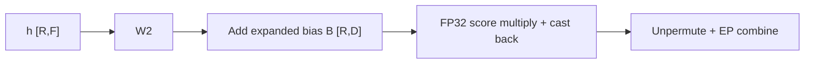
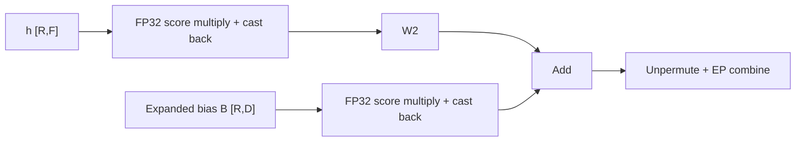
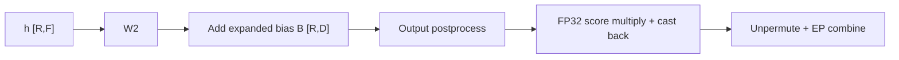

# Router-score absorption

[`RoutedExperts`](moe.py) absorbs DeepEP and HybridEP router scores into W2's
input when `output_postprocess` is absent. Local and AllToAll keep post-expert
scoring; Dist-MoE owns its compute and communication optimizations. This extends
the DeepEP optimization from [#5543](https://github.com/pytorch/torchtitan/pull/5543)
to HybridEP through shared `EPDispatchMetadata.scores_R`.

`R` is the number of routed rows on this rank, `D` the model dimension, `F` the
expert intermediate dimension, and `E` the number of local experts. Dispatch
groups rows by expert, so W2 consumes `h_RF` with per-row scores `s_R`.

## Scoring before W2

Without absorption, each expert output is multiplied by its router score:



For a linear W2, scores can instead multiply its input:



Each score multiplication broadcasts scores as `[R, 1]`. The bias branch is
present only
for biased experts, such as GPT-OSS. W13's bias is added before the activation
and is not scaled separately.

An expert's stored bias has shape `[E, D]`, whereas the diagram uses a bias
expanded over routed rows:

```text
B_RD[r, :] = b_ED[expert_for_row(r), :]
y_RD       = s_R[:, None] * (W2(h_RF) + B_RD)
           = W2(s_R[:, None] * h_RF) + s_R[:, None] * B_RD
```

[`GptOssGroupedLinear._expand_grouped_bias`](../../gpt_oss/moe.py) constructs
this row-aligned bias using the same expert offsets as grouped GEMM. Scores
therefore scale the selected expert's bias for each row, not the expert axis.
Padding rows receive zero bias.

## Output postprocessing

A postprocess such as expert-output normalization need not commute with score
multiplication. Both backends retain post-expert scoring when it is configured:



Thus `s * output_postprocess(W2(h) + B)` keeps the original operation order.
The combine backend receives weighted outputs in both paths.

## Precision

Score products compute in FP32 and then convert back to the activation dtype.
For example, [`GroupedLinear`](../linear/linear.py) uses type promotion:

```python
scaled_RF = (h_RF * s_R.float().reshape(-1, 1)).to(h_RF.dtype)
```

Leaving the activation operand in its original dtype avoids materializing an
FP32 activation copy that multiplication would otherwise save for backward.
The algebra above holds in exact arithmetic. Casting the scaled input before
W2 changes rounding relative to scoring W2's output; FP32 multiplication does
not guarantee identical BF16 outputs, losses, or gradients.

## Checkpoint dependencies

Post-W2 scoring needs the unscaled expert output for the score gradient.
Absorption moves that dependency to W2's input and input gradient. Its biased
branch adds pointwise multiplication and reductions, not another GEMM.

DeepEP wraps all of `combine_tokens`, including unpermute, in a SAVE region.
Replaying unpermute would require retaining or rebuilding W2's output. Saving
it instead retains the routing indices needed by unpermute backward: `R`
int64 indices occupy `8R` bytes, or 256 KiB at `R = 32768`. This counts index
storage, not the opaque DeepEP handle or other retained tensors.

Scores are supplied by replayed dispatch/permutation or retained dispatch
outputs. The optimized combine does not consume scores. W2 follows its
configured remat policy, and the GPT-OSS bias addition follows the same
`grouped_mm` decision rather than an independent bias policy. Replaying even a
cheap bias addition after a saved matmul would retain the matmul's full routed
output; saving both avoids this dependency. A real dtype conversion or output
postprocess still consumes W2's output. With W2 saved it remains resident; under
full remat W2 and its bias addition replay. Full remat also replays W2 in the
common BF16 path: absorption enables saving W2 without retaining its output,
but does not itself change W2's policy.

## HybridEP dispatch and combine

HybridEP returns its permuted FP32 scores explicitly with dispatched rows.
The same W2-input and GPT-OSS bias scaling above applies; with postprocessing,
the shared expert path scores after that postprocess. Combine accepts weighted
rows and never multiplies scores a second time. Blocking and nonblocking modes
use the same scoring contract, including aligned padding and capacity-limited
dispatch. Absorption does not change capacity sizing or restore dropped tokens.

HybridEP combine is always a SAVE region, including its fused unpermutation.
Its backward needs the opaque forward dispatch handle, not the expert output.
That handle retains routing maps, so this is not the DeepEP `8R`-byte index-only
storage example above. Dispatch still follows `ep_communication`: integer
prefix scans reproduce row positions on replay, keeping rebuilt activations
and scores aligned with the forward handle used by saved combine. Backward
communication still runs; only forward combine replay is skipped.

The earlier HybridEP path cast router scores to the activation dtype before
post-W2 multiplication. The current path keeps scores in FP32 until the product
is cast back. Both this precision change and moving multiplication across W2
can change BF16 outputs and gradients; this is not a bitwise-preserving change.
