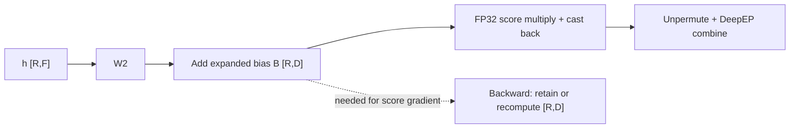
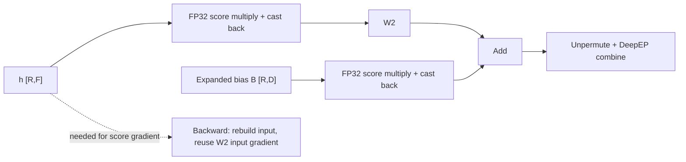
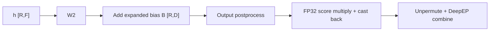

# Router-score absorption

[`RoutedExperts`](moe.py) absorbs DeepEP router scores into W2's input when
`output_postprocess` is absent. Local, AllToAll, and HybridEP keep post-expert
scoring; Dist-MoE owns its compute and communication optimizations. The design
and motivation are discussed in [#5543](https://github.com/pytorch/torchtitan/pull/5543).

`T` is the number of input tokens on this rank, `R` the number of routed rows,
`D` the model dimension, `F` the expert intermediate dimension, and `E` the
number of local experts. Dispatch
groups rows by expert, so W2 consumes `h_RF` with per-row scores `s_R`.

## Motivation: remove a backward dependency

Applying a router score after W2 makes the score gradient depend on W2's
unscaled output. That `[R, D]` tensor can be much larger than a layer's `[T, D]`
combined output because each token visits several experts. Keeping it costs
memory; discarding it requires another W2 forward GEMM during backward.

Absorption moves the score multiplication before the linear projection. The
score gradient then uses the already-required W2 input gradient instead of
W2's output. This allows a remat policy to save W2 without retaining its full
routed output: its input can be rebuilt with elementwise operations. It removes
the need to choose between keeping the output and replaying that GEMM.

For one bias-free routed row, write W2 as a matrix `W`, its input as `h`, its
score as `s`, and the gradient of the weighted output as `g`:

```text
Score after W2                         Score before W2

z = W @ h                             a = s * h
y = s * z                             y = W @ a

Backward:                             Backward:
  dz = s * g                            da = W.T @ g
  dh = W.T @ dz                         dh = s * da
  dW = dz @ h.T                         dW = g @ a.T
  ds = dot(g, z)                        ds = dot(da, h)
              ^                                        ^
  needs W2's forward output             needs input and input gradient
  (retain z or rebuild W @ h)            (no dependency on W @ a)
```

Both forms still need W2's ordinary input-gradient and weight-gradient GEMMs.
The optimization concerns retention or replay of its **forward output**; it
does not remove the work needed to differentiate W2.

## Scoring before W2

Without absorption, each expert output is multiplied by its router score:



For a linear W2, scores can instead multiply its input:



Each score multiplication broadcasts scores as `[R, 1]`. The bias branch is
present only for biased experts, such as GPT-OSS. W13's bias is added before
the activation and is not scaled separately.

An expert's stored bias has shape `[E, D]`, whereas the diagram uses a bias
expanded over routed rows:

```text
B_RD[r, :] = b_ED[expert_for_row(r), :]
y_RD       = s_R[:, None] * (W2(h_RF) + B_RD)
           = W2(s_R[:, None] * h_RF) + s_R[:, None] * B_RD
```

[`GptOssGroupedLinear._expand_grouped_bias`](../../gpt_oss/moe.py) constructs
this row-aligned bias using the same expert offsets as grouped GEMM. Scores
therefore scale the selected expert's bias for each row, not the expert axis.
Padding rows receive zero bias. The bias branch adds pointwise operations and
reductions, not another GEMM.

## Output postprocessing

A postprocess such as expert-output normalization need not commute with score
multiplication. DeepEP retains post-expert scoring when it is configured:



Thus `s * output_postprocess(W2(h) + B)` keeps the original operation order.
The combine backend receives weighted outputs in both paths. This path does
not gain the backward-dependency removal described above.

## Precision

Score products compute in FP32 and then convert back to the activation dtype.
For example, [`GroupedLinear`](../linear/linear.py) uses type promotion:

```python
scaled_RF = (h_RF * s_R.float().reshape(-1, 1)).to(h_RF.dtype)
```

Leaving the activation operand in its original dtype avoids materializing an
FP32 activation copy that multiplication would otherwise save for backward.
The algebra above holds in exact arithmetic. Casting the scaled input before
W2 changes rounding relative to scoring W2's output; FP32 multiplication does
not guarantee identical BF16 outputs, losses, or gradients.

## Memory and recompute tradeoffs

The table isolates the W2/score dependency for bias-free BF16 experts with no
postprocess and no dtype conversion between W2 and combine. "Post-W2" is a
comparison computation, not a DeepEP configuration switch. Other layer
activations, parameters, communication buffers, and temporary workspaces are
excluded. The comparison replays post-W2 scoring under remat; placing that
scoring inside a SAVE region would retain its `[R,D]` operand even when W2
itself is configured to replay.

| Policy | Score after W2 | Absorption with saved DeepEP combine |
| --- | --- | --- |
| No remat | Autograd retains the unscaled `[R,D]` output for `ds`, and `[R,F]` input for `dW`. | No unscaled W2 output is needed. Autograd instead needs both original and scaled `[R,F]` inputs. The extra scaled input offsets some or all of the removed output storage. |
| Selective remat with W2 saved | Scoring needs the unscaled `[R,D]` output, so saving W2 keeps that output resident. | The W2 output need not stay resident. Replay rebuilds the scaled input for W2 backward; the W2 forward GEMM is skipped. |
| Full remat (`FullActivationRematConfig`) | W2 output can be discarded, then rebuilt during backward. | W2 output need not remain resident, but W2's `grouped_mm` is still configured to replay. Absorption alone does not change this policy. |

With absorption, the middle row obtains the low W2-output retention of full
remat while avoiding its W2 forward replay. The default
`DefaultActivationRematConfig` already saves W2. For an explicit policy that
otherwise recomputes everything, save W2 as follows:

```python
from torchtitan.distributed.activation_remat import ActivationRematConfig

config.activation_remat = ActivationRematConfig(
    save_regions=["*routed_experts.w2.grouped_mm"],
)
```

This still replays dispatch and W13, while DeepEP combine is always saved.
Adding `"*token_dispatcher.ep_communication"` also saves dispatch. Dispatch
replay uses deterministic receive ordering, which adds a sort per dispatch.
See [REMAT.md](../../../distributed/REMAT.md) for region matching and policy
semantics. Under `torch.compile`, the graph partitioner also determines the
actual replay work; inspect the resulting graph or profile rather than
inferring GEMM counts from a policy name alone.

For a bias-free W2, each avoided forward replay costs approximately `2RFD`
FLOPs. Rebuilding scaled inputs costs `RF` multiplications, and scaling and
score-gradient reductions move from width `D` to width `F`. GPT-OSS also scores
its expanded bias at width `D`. These pointwise operations are not free, and a
FLOP estimate is not a measurement of step time or communication overlap.

### Storage example

One BF16 routed output occupies `2 * R * D` bytes. For `R = 32768` and `D = 7168`,
that is **448 MiB per MoE layer**. Across 58 such layers it is **25.4 GiB** of
potentially avoided output retention with saved W2. This is an illustrative
storage calculation, not a measured peak-memory reduction: actual `R` varies
with routing, EP layout, and padding, and the rest of the model also retains
tensors.

Removing an unnecessary pin on the combined `[T,D]` output is a separate
saving. At `T = 4096` and the same `D`, that tensor is 56 MiB per layer (3.17 GiB
across 58 layers). That gain comes from skipping replay of trailing consumers,
not from moving the score multiplication. Neither calculation includes
allocator reuse or transient peak memory.

### Why save the whole combine region?

DeepEP wraps all of `combine_tokens`, including unpermute, in a SAVE region.
Replaying unpermute would require retaining or rebuilding W2's output even
after absorption. Saving it instead retains the routing indices needed by
unpermute backward: `R` int64 indices occupy `8R` bytes, or 256 KiB at
`R = 32768`. This counts index storage, not the opaque DeepEP handle or other
retained tensors. Skipping forward replay of combine does not skip its
communication during the original forward or backward.

Scores are supplied by replayed dispatch/permutation or retained dispatch
outputs. The optimized combine does not consume scores. W2 follows its
configured remat policy, and the GPT-OSS bias addition follows the same
`grouped_mm` decision rather than an independent bias policy. Replaying even a
cheap bias addition after a saved matmul would retain the matmul's full routed
output; saving both avoids this dependency.

### Limits of the saving

- Without remat, GPT-OSS's score-gradient computation retains expanded bias
  `[R,D]`. Removing the unscaled W2 output therefore does not remove all
  activation storage of that size. Under remat, the expanded bias is cheaply
  rebuilt from per-expert bias and offsets.
- A real dtype conversion after W2 reads its output during replay. With W2
  saved, that output must stay resident; full remat rebuilds it. A no-op
  `type_as` in the common BF16 path does not impose this dependency.
- `output_postprocess` disables absorption and reads W2's output. Saving combine
  does not remove the output dependencies of normalization or post-expert
  scoring.
- Local, AllToAll, and HybridEP keep their existing post-expert scoring and
  remat behavior. Dist-MoE manages these choices internally.

Use `torch_remat.collect_trace()` to check the effective regions and
`torch_remat.format_saved_tensors_report(loss)` to inspect resident retained
storage. Compare peak memory and steady-state step time on the target model
and topology separately; retained-storage totals do not measure either one.
