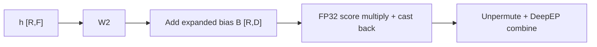
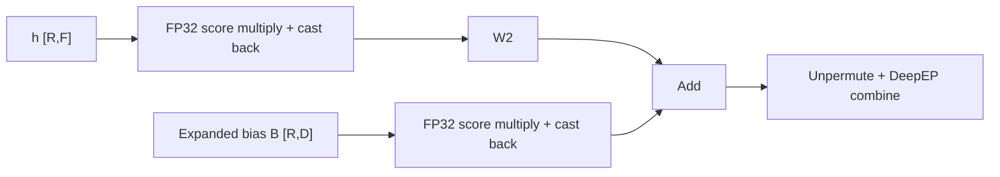
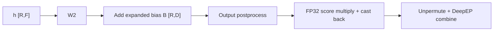

# Router-score absorption

[`RoutedExperts`](moe.py) absorbs DeepEP router scores into W2's input when
`output_postprocess` is absent. Local, AllToAll, and HybridEP keep post-expert
scoring; Dist-MoE owns its compute and communication optimizations.

`R` is the number of routed rows on this rank, `D` the model dimension, `F` the
expert intermediate dimension, and `E` the number of local experts. Dispatch
groups rows by expert, so W2 consumes `h_RF` with per-row scores `s_R`.

## Scoring before W2

Without absorption, each expert output is multiplied by its router score:



For a linear W2, scores can instead multiply its input:



Each score multiplication broadcasts scores as `[R, 1]`. The bias branch is
present only
for biased experts, such as GPT-OSS. W13's bias is added before the activation
and is not scaled separately.

An expert's stored bias has shape `[E, D]`, whereas the diagram uses a bias
expanded over routed rows:

```text
B_RD[r, :] = b_ED[expert_for_row(r), :]
y_RD       = s_R[:, None] * (W2(h_RF) + B_RD)
           = W2(s_R[:, None] * h_RF) + s_R[:, None] * B_RD
```

[`add_grouped_bias`](../../gpt_oss/moe.py) gathers this row-aligned bias by
expert id, using the same expert offsets as grouped GEMM. Scores therefore
scale the selected expert's bias for each row, not the expert axis. Padding
rows receive zero bias.

## Output postprocessing

A postprocess such as expert-output normalization need not commute with score
multiplication. DeepEP retains post-expert scoring when it is configured:



Thus `s * output_postprocess(W2(h) + B)` keeps the original operation order.
The combine backend receives weighted outputs in both paths.

## Precision

Score products compute in FP32 and then convert back to the activation dtype.
For example, [`GroupedLinear`](../linear/linear.py) uses type promotion:

```python
scaled_RF = (h_RF * s_R.float().reshape(-1, 1)).to(h_RF.dtype)
```

Leaving the activation operand in its original dtype avoids materializing an
FP32 activation copy that multiplication would otherwise save for backward.
The algebra above holds in exact arithmetic. Casting the scaled input before
W2 changes rounding relative to scoring W2's output; FP32 multiplication does
not guarantee identical BF16 outputs, losses, or gradients.

GPT-OSS's compiled `grouped_expert_bias` region does not convert the scaled
bias back: it adds it to W2's output in FP32 and rounds once.

## Checkpoint dependencies

Post-W2 scoring needs the unscaled expert output for the score gradient.
Absorption moves that dependency to W2's input and input gradient. Its biased
branch adds pointwise multiplication and reductions, not another GEMM.

DeepEP wraps all of `combine_tokens`, including unpermute, in a SAVE region.
Replaying unpermute would require retaining or rebuilding W2's output. Saving
it instead retains the routing indices needed by unpermute backward: `R`
int64 indices occupy `8R` bytes, or 256 KiB at `R = 32768`. This counts index
storage, not the opaque DeepEP handle or other retained tensors.

Scores are supplied by replayed dispatch/permutation or retained dispatch
outputs. The optimized combine does not consume scores. W2 follows its
configured remat policy, and the GPT-OSS bias addition follows the same
`grouped_mm` decision rather than an independent bias policy. Replaying even a
cheap bias addition after a saved matmul would retain the matmul's full routed
output; saving both avoids this dependency. Other replayed consumers, such as a
dtype conversion, can still need W2's output, so saved combine alone does not
guarantee its complete removal from retained memory. FullAC can still replay
the W2 GEMM and its bias addition.
