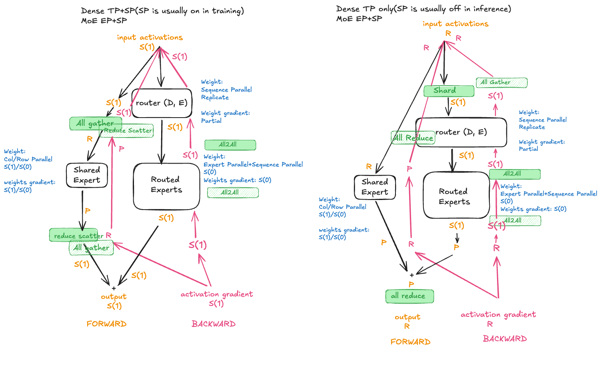

# MoE Sharding

Config-based sharding for MoE submodules, implemented in
[`sharding.py`](sharding.py). Mesh axis names (`ep`, `edp_shard`) and how
EP reuses ranks from the dense world mesh are in
[`torchtitan/distributed/PARALLELISM_CONTEXT.md`](../../../distributed/PARALLELISM_CONTEXT.md).

## Overview

The diagram below shows the MoE layer's SPMD layout flow using `spmd_types` for
the two supported expert-parallel configurations (SP on/off). For MoE models,
`expert_parallel_degree` must be at least `tensor_parallel_degree`.

[Excalidraw source](https://excalidraw.com/#json=fZ1o2BuwXSVIGQhXM5gbr,KHKKckUbQXm68uiS3i_L7w)

## Configurations

"MoE input" is the TP layout at the MoE boundary. "Routed input" is the
layout change `MoE.forward` makes explicitly before routed-expert dispatch and
computation. "MoE output" is the combined output layout and the explicit
collective that produces the boundary layout.
"Routed expert weights" describes the routed expert weight placement.

| Config | Routed expert mesh | Routed expert weights | MoE input | Routed input | MoE output |
|--------|-------------------|----------------------|-----------|--------------|------------|
| EP on, SP on | sparse (`ep`/`edp_shard`) | `Shard(0)` on EP | `Shard(0)` | `Shard(0)` (no-op) | `Shard(0)` |
| EP on, SP off | sparse (`ep`/`edp_shard`) | `Shard(0)` on EP | `Invariant` | `Invariant` -> `Shard(0)` | `Partial` -> `Invariant` (all-reduce) |

## Submodule sharding

- **MoE wrapper**: `ShardingConfig` only asserts the residual layout of the
  input and output; it inserts no collectives. With EP and SP off,
  `MoE.forward` explicitly shards the tokens across TP before routing,
  zero-fills the routed output to `Partial`, and all-reduces the combined
  output once. Without EP, TP/SP are disabled and routed-expert activations
  remain replicated.
- **Router gate**: weights `Replicate`, output stays DTensor.
- **Shared experts** (w13/w2): dense-family TP plan. `ColumnParallelLinear`
  gathers the w13 input. The local w2 projection produces `Partial`. With EP
  and SP off, it stays `Partial` until the shared and routed paths are added,
  then the MoE boundary performs the single all-reduce. With SP on, the w2
  boundary reduces `Partial` to `Shard(0)` before the paths are added.
- **Routed experts** (`RoutedExperts`): the local SPMD region runs
  dispatch/compute/combine on local tensors while checking its input and
  output layout contracts. Expert-weight `state_shardings` live on its `w13`
  and `w2` grouped linears and are unsharded when EP is disabled.
- **Routed-output postprocessing**: `output_postprocess` operates on dispatched
  expert outputs on the sparse expert mesh. `offsets_E` is required to
  identify which rows of `routed_output_RD` is from which expert.
  Currently, `output_postprocess` only takes in `routed_output_RD`,
  and thus the same operation must be applied to all of the expert outputs.
  So its parameters should use `Replicate` on `dp_replicate`,
  `edp_shard`, and `ep`.
