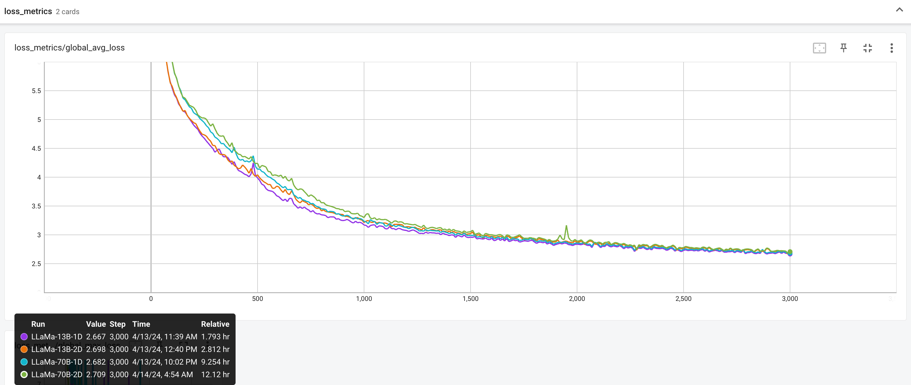

# Llama 3

Llama 3 is the reference decoder model in torchtitan. Training recipes cover
Llama 3.1 8B, 70B, and 405B, plus a small debug model used by CI.

## Download the tokenizer

Follow the access instructions on the official
[meta-llama](https://huggingface.co/meta-llama/Llama-3.1-8B) repository, then:

```bash
python scripts/download_hf_assets.py --repo_id meta-llama/Llama-3.1-8B --assets tokenizer
```

The 8B, 70B, and 405B recipes expect tokenizer assets under
`./assets/hf/Llama-3.1-8B` (and the matching 70B / 405B paths).

## Training

```bash
# Debug model (used by integration tests)
MODULE=torchtitan_recipes.tests.models.llama3 CONFIG=llama3_debugmodel ./run_train.sh

# Llama 3.1 8B
MODULE=torchtitan_recipes.models.llama3 CONFIG=llama3_8b ./run_train.sh
```

Other recipes include `llama3_70b`. See
[`torchtitan_recipes/models/llama3.py`](../../../torchtitan_recipes/models/llama3.py).

## Supported Parallelisms

Coverage below matches the sharding set in [`flavors.py`](./flavors.py),
`BaseModel.parallelize()`, and the Llama 3 jobs in
`tests/integration_tests/features.py`.

| Feature | Notes |
|---------|-------|
| FSDP / HSDP | Default data-parallel path |
| Tensor Parallel (TP) | Including sequence parallel; async TP is exercised on H100 |
| Context Parallel (CP) | Composes with FSDP, HSDP, DDP, and TP |
| Pipeline Parallel (PP) | 1F1B, Interleaved1F1B, and GPipe. Zero-bubble / split-backward PP tests are disabled in `tests/integration_tests/features.py` because FlexInnerAttention `BlockMask` is not a Tensor |
| DDP | Including DDP+CP |
| Activation checkpointing | Selective and full |
| `torch.compile` | 1D and multi-dimensional jobs |
| MXFP8 | Eager `llama3_8b_mxfp8` in `torchtitan_recipes.tests.models.llama3`; GraphTrainer `graph_trainer_llama3_debugmodel_mxfp8` in `torchtitan_recipes.tests.graph_trainer.llama3` |

## Numerical checks

Llama 3 is the baseline used to validate distributed training techniques. See
`tests/integration_tests` and the
[validation guide](../../../docs/debugging.md#validating-a-distributed-training-technique)
rather than treating any single published KL or MFU number as a parity claim.

### Loss convergence

A reference convergence run on Llama 3.1 8B, covering parallelisms and training
optimizations, following the validation guide's methodology. Results were
obtained on 2025-01-21 with the then-latest `torch`, `torchao`, and `torchtitan`.

- Base recipe: `llama3_8b` from [torchtitan_recipes/models/llama3.py](../../../torchtitan_recipes/models/llama3.py)
- 262144 tokens per step: DP degree 8, one gradient accumulation step, and
  32768 tokens per microbatch without PP or 8192 tokens with four PP microbatches
- 3000 steps with 600 warmup steps

| Parallelism              | Techniques                                        | Remarks                           |
| ------------------------ | ------------------------------------------------- | --------------------------------- |
| FSDP 8                   | default                                           | 1D control set                    |
| FSDP 8, TP 2, PP 2       | torch.compile, Float8, async TP, Interleaved 1F1B | 3D test set                       |
| FSDP 8, TP 2, CP 2, PP 2 | torch.compile, Float8, async TP, Interleaved 1F1B | 4D test set                       |
| FSDP 8, CP 8             | default                                           | to verify CP with a larger degree |


