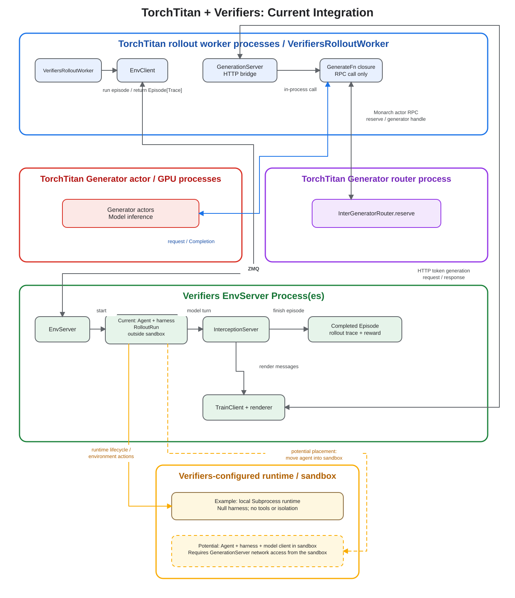

# Verifiers integration

This directory contains the optional bridge between TitanRL and
[Verifiers](https://github.com/PrimeIntellect-ai/verifiers). Other TitanRL
recipes do not import or require Verifiers.

The ownership boundary is:

- TitanRL loads samples, schedules rollout groups, routes generation, tracks
  policy versions, computes advantages, and trains the policy.
- Verifiers runs the environment, agent or tool loop, runtime, and task reward.
- The adapter converts samples and traces between the two systems.

Reusable bridge code lives alongside this README. Each experiment has its own
package and dependencies: [`dapo_math/`](./dapo_math) (single-turn math) and
[`terminal_bench/`](./terminal_bench) (multi-turn terminal agent on Harbor tasks).

## Integration flow



1. [`data.py`](./data.py) loads a Verifiers taskset in the TitanRL controller,
   where TitanRL samples each rollout task. It converts the task's typed data
   to a plain dictionary because `VerifiersEnvClient` sends that data as
   msgpack over ZMQ to the separately spawned environment-server process. The
   server reconstructs the typed task before running the Verifiers environment.
2. [`env_server.py`](./env_server.py) currently spawns and owns the Verifiers server as
   a separate local process on the TitanRL controller host. The configured
   Verifiers runtime is independent: for example, `SubprocessConfig` or
   `DockerConfig` for the agent. Each pool worker imports the taskset and harness by
   id (below), so the modules it imports must not import torch.
3. [`generation_server.py`](./generation_server.py) exposes TitanRL's `GenerateFn` through the
   HTTP token-generation protocol expected by Verifiers. It also retains the
   policy-version span and metrics that are absent from Verifiers traces.
4. `rollouter.py` sends samples to Verifiers and converts the
   returned trace graph into TitanRL `RolloutTurn` objects. TitanRL then applies
   its rubric and advantage estimator normally.

The training dataset is the single source of the environment taskset config.
`VerifiersRollouter.Config` copies it into the environment-server config, so an
experiment must not configure the same taskset a second time.

For CPU-heavy environments, increase the Verifiers worker-pool size first. A
future implementation could instead place the environment server in a Monarch
actor. That would require routable ZMQ and generation-server addresses plus
actor-owned startup and shutdown; the current integration does not provide
that placement mode.

## Taskset ids

Verifiers imports a taskset, harness or env by the name of a top-level package. It
takes the one subclass of each base class that the package lists in `__all__`. Each
env-server worker resolves the ids again in a fresh process, so the package must be
importable there:

```text
id "torchtitan_verifiers_terminal_bench" -> import torchtitan_verifiers_terminal_bench
                                            Taskset, Harness and Env from its __all__
id "torchtitan_verifiers_dapo_math"      -> import torchtitan_verifiers_dapo_math
                                            Taskset from its __all__
```

The two examples keep their code in this folder and re-export it from those repo-root
packages. TorchTitan ships them (`pyproject.toml`), so they need no install step. An
editable install (`pip install -e .`) lists top-level packages when it runs: re-run it
once after pulling a new one.

## Add an experiment

For your own env, ship a top-level package in your own project, list its `Taskset`
(and its `Env` or `Harness`, if any) in `__all__`, and pass the package name as the id.
An in-repo example ships its package at the repo root, as `torchtitan_verifiers_<name>/`:
`pyproject.toml`, the labeler and the reviewer routing already match that prefix.
Create one package per task, with its own dependency list:

```text
torchtitan_verifiers_my_task/
  __init__.py          # __all__ = ["MyTaskset"], re-exported from my_task/data.py
torchtitan/rl/examples/verifiers/
  data.py
  env_server.py
  generation_server.py
  rollouter.py
  my_task/
    __init__.py
    recipe module
    data.py
    requirements.txt
    rollouter.py
```

1. In `data.py`, define the Verifiers `Taskset` and `TasksetConfig`.
2. In `rollouter.py`, put that config, with `id="torchtitan_verifiers_my_task"`, in
   `VerifiersTaskDataset.Config.verifiers_taskset`. Configure the agent,
   harness, runtime, and worker pool, but leave
   `verifiers_env_server.environment.taskset` unset; `VerifiersRollouter`
   derives it from the training dataset.
3. In `recipe module`, select the rollouter from `Controller.Config`.
4. Place the module under `torchtitan/rl/examples` or pass its fully qualified
   module path to `--module`.

Run the recipe with:

```bash
python -m torchtitan.rl.train \
  --module verifiers.my_task \
  --config <config-name>
```

See [DAPO Math](./dapo_math) for a complete single-turn example and
[Terminal-Bench](./terminal_bench) for a multi-turn agent example. This
integration pins Verifiers 0.4.0 and uses its `verifiers.v1` API.
