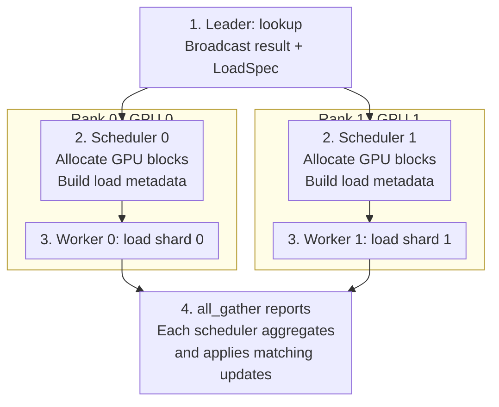

# Distributed CPU KV cache

Titan RL uses vLLM's
[`MooncakeStoreConnector`](https://docs.vllm.ai/en/latest/features/mooncake_store_connector_usage/)
to share prompt and optional decode KV across generators through a distributed
CPU DRAM pool. Generators keep their local GPU cache; misses recompute from the
request's full token history.

Store manages CPU capacity and eviction; vLLM manages GPU blocks. The shared pool
works without prefill/decode disaggregation. The separate
[`MooncakeConnector`](https://github.com/vllm-project/vllm/blob/main/vllm/distributed/kv_transfer/kv_connector/v1/mooncake/mooncake_connector.py)
handles point-to-point prefill/decode transfers.

## Setup

Install a compatible Mooncake SDK on each generator host (tested:
`mooncake-transfer-engine==0.3.13.post1`). RDMA requires RNICs, GPU memory
registration, and the SDK's native libraries. Start a reachable Master for metadata:

```bash
mooncake_master --rpc_port=50051
```

Set `MOONCAKE_CONFIG_PATH` in every generator process to a local JSON file:

```json
{
  "mode": "embedded",
  "metadata_server": "P2PHANDSHAKE",
  "master_server_address": "MASTER_HOST:50051",
  "global_segment_size": "8GB",
  "local_buffer_size": "1GB",
  "protocol": "rdma",
  "device_name": "",
  "enable_offload": false
}
```

- `global_segment_size` is DRAM **per worker**: four workers at 8 GB use 32 GB.
  Leave room for weight-prefetch buffers and other host processes.
- `enable_offload` controls the **disk tier**; CPU offload works with `false`.

Host-specific settings used in the RDMA test:

- Set `expandable_segments:False` in both `PYTORCH_ALLOC_CONF` and
  `PYTORCH_CUDA_ALLOC_CONF` before importing PyTorch. Expandable allocations
  have not been validated.
- Set `WITH_NVIDIA_PEERMEM=0` for the tested SDK's DMA-BUF path.
- Set `VLLM_HOST_IP` only if auto-detection fails. Use a routable address for
  multiple hosts; `127.0.0.1` was used for the single-host test.

## Generator configuration

```python
from vllm.config import KVTransferConfig

from torchtitan.rl.generator.vllm.engine import VLLMEngine
from torchtitan.rl.routing.inter_generator import InterGeneratorRouter

engine = VLLMEngine.Config(
    kv_transfer_config=KVTransferConfig(
        kv_connector="MooncakeStoreConnector",
        kv_role="kv_both",
        kv_connector_extra_config={
            "cache_prefix": "unique-run-and-model-id",
            "save_decode_cache": True,
        },
    ),
)
generator_router = InterGeneratorRouter.Config(hot_swap=False)
```

- Use a shared, non-empty `cache_prefix` that is **new for each run or restart**,
  including checkpoint resume. Generators sharing KV must match model, dtype,
  KV layout, runtime versions, and hash settings, including any `PYTHONHASHSEED`
  override. Prefix caching and hashing otherwise use vLLM defaults.
- `kv_both` enables reads and writes; `save_decode_cache=True` also saves generated
  KV. `kv_consumer` skips prefill saves but can save decode KV when requested.
  `kv_producer` requires `enable_lookup=False` because vLLM protects asynchronous
  load destinations only for consumers. `load_async=False` is unsupported.
- Do not set `lookup_rpc_port`: Titan derives this IPC socket name for each
  generator so replicas on one host cannot unlink each other's lookup socket.

The opt-in recipe `rl_grpo_qwen35_9b_terminal_bench_mooncake` configures a fresh
shared namespace and drained weight updates. The base
`rl_grpo_qwen35_9b_terminal_bench` recipe does not require Mooncake.

## Weight and cache lifecycle

- Load trainer weights before the first request. Titan includes the **loaded
  policy version** in cache keys so weight updates cannot reuse stale KV.
- Keep `generator_router.hot_swap=False` to drain model calls before weight
  updates, and `reset_kv_cache_on_model_state_dict_load=False`: asynchronous saves
  can still hold GPU blocks after a response. The engine drains pending transfers.
- Old policy entries remain available until Store evicts them. Do not call
  `reset_prefix_cache(reset_connector=True)` on a replica; it can clear the
  shared Store globally.

## Supported configurations

- **Multi-GPU:** Titan's TP and DP/EP layouts are supported. TP ranks coordinate
  KV lookup and completion using shared logical request IDs while retaining
  rank-local vLLM IDs; DP groups coordinate progress. Use `num_generators` for
  independent replicas.
- **Connector:** select the built-in `MooncakeStoreConnector`; Titan installs its
  lifecycle adapter. `kv_transfer_config=None` disables it. For local CPU offload,
  use [SimpleCPU](SIMPLE_CPU_OFFLOAD.md).
- **Sessions:** enabling `session_kv_holder` retains local GPU KV between turns.
  Session release frees local GPU holds. Store always manages CPU eviction:
  a generator cannot determine whether another generator still needs a prefix.
- **Unsupported:** `MultiConnector`, custom connectors, batch-invariant mode,
  and standalone `generate.py`.

## Multi-GPU coordination

With `external_launcher`, each GPU process runs a scheduler and a worker.
Asynchronous cache events can arrive at different times on each rank, so Titan
coordinates two scopes within a generator:

| Scope | What stays coordinated | Implementation |
| --- | --- | --- |
| **One TP group** | Request order, cache lookup results, transfer completion, and GPU block release for the same requests. | [lookup](mooncake.py), [shared coordination](cpu_kv_offload.py) |
| **All ranks in a generator** | Whether to keep stepping or wait; participation in EP forwards across DP replicas. | [engine.py](engine.py), [engine_loop.py](../engine_loop.py) |

Independent generators share the Store but do not join these collectives.

### Cache reuse within a TP group

Cache-hit flow for `TP=2` within one DP replica. The leader's lookup service
checks all required TP shards. If loading is needed, each worker loads its own
shard from the Store.



- **Lookup and allocation:** `LoadSpec` describes cached token ranges and tail
  boundaries. Each scheduler then allocates destination GPU blocks and adds their
  local IDs to its worker's load metadata. Pending lookups retry on later steps.
- **Completion:** reports may be empty while transfers are in flight. Each
  scheduler accumulates reports across steps, waiting for all required TP workers
  before completing a load or releasing a save job's GPU references. Collectives
  exchange metadata only; KV tensors move between each worker and the Store.
- **Request IDs:** request completion reports use shared Titan IDs for aggregation,
  then map back to each scheduler's local vLLM IDs before updating its request state.

### Progress across DP/EP ranks

Each DP replica has its own requests, TP group, and lookup service. Cache hits and
completion counts stay within that TP group. In Titan's supported layouts,
`DP>1` supplies ranks for EP, so replicas still need to participate in the same
model forwards.

At a common step boundary, all generator ranks use an `all_reduce(MAX)` over
whether requests, scheduler work, or queued outputs remain. If any rank has
work, all continue stepping; idle DP replicas join required EP forwards with
dummy batches. This also drains KV saves after the last response, before the
generator waits for new requests.

## Validation

Select idle RDMA-capable GPUs with `CUDA_VISIBLE_DEVICES` and run from the repo
root. The full matrix needs eight GPUs; use `-k 'not tp2 and not dp2'` for two.

```bash
RUN_MOONCAKE_TEST=1 pytest -s tests/rl/unit_tests/gpu/test_kv_offload.py
```

Tests cover shared KV reuse, policy-version isolation, TP/DP/EP coordination,
and hybrid partial-tail saves after the last request finishes.
The Mooncake GPU matrix is opt-in because it needs a Mooncake SDK and RDMA
hardware that the default RL CI image does not provide. The Gloo coordination
and no-forward save regressions run in the CPU suite without a Store.
Multi-node operation and the full Terminal-Bench recipe remain unvalidated.

### Local performance sample

Tested on one host with eight H100s: a two-GPU FSDP=2 trainer and six independent
single-GPU generators, using the random-init Qwen3.5 debug model (8 layers,
dim 256, BF16). Store used 1 GiB of DRAM per worker; disk offload and CUDA graphs
were disabled.

The synthetic workload used four prompts with two samples each per training
step. Each rollout had four turns: 1024 initial tokens, 32 generated tokens per
turn, and 192 new input tokens between turns. Fixed routing sent each turn to a
different generator, with local prefix caching enabled in both OFF and ON. This left
75% of requests with no local cache hit.

Three OFF/ON pairs ran 12 training steps each. Results below summarize steps
3-12 (320 requests per run), taking the median across runs for each metric.

| Metric | Mooncake OFF | Mooncake ON |
| --- | ---: | ---: |
| Requests reusing Store KV | 0 | 244 / 320 |
| Prefill tokens computed | 353,280 | 132,608 |
| Mean prefill interval | 65.6 ms | 52.9 ms |
| Mean queued interval | 1.5 ms | 32.6 ms |
| Rollout throughput | 1.620/s | 1.613/s |
| Total time for 10 training steps | 49.39 s | 49.58 s |

Store reuse reduced prefill token computation by 62.5%, but did not produce a
consistent end-to-end speedup: paired total-time changes ranged from -1.6% to
+2.3%. Queued time includes waiting for asynchronous KV lookup/load; the prefill
interval runs from first scheduling to first token, not just GPU compute. These
single-host, short-context debug-model results do not establish production
performance.

### Concurrent TP cache-pressure sample

A separate Qwen3-8B generator benchmark used one TP group on H100s, four
interleaved four-turn sessions with two concurrent requests, FULL CUDA graphs,
and 4 GiB of Store DRAM per worker. Prompts began with 8,192 tokens; each turn
generated 32 tokens and added 192 input tokens. Each run had two warmup cycles
and five measured cycles (80 measured requests).
Three OFF/ON pairs compared native GPU prefix caching with the same GPU cache
plus Mooncake. The GPU cache had 80 blocks to exercise CPU reloads.

| TP | OFF sessions/s | ON sessions/s | Change | Median requests with CPU hits |
| --- | ---: | ---: | ---: | ---: |
| 2 | 0.8362 | 0.9395 | +12.36% | 25 / 80 |
| 4 | 1.2580 | 1.3621 | +8.27% | 34 / 80 |

With a roomy 512-block GPU cache, neither arm needed CPU reloads; throughput
changed by +1.65% (TP=2) and -2.05% (TP=4). These are generator throughput
measurements, not cross-generator or full RL training speedups.

The recompute comparison had identical greedy tokens in TP=2 and two differing
requests out of 80 in TP=4. GPU-cache and CPU-cache arms reused different prefix
lengths, so these measurements do not establish bitwise numerical parity.
The sample predates the config validation and session-release changes in this PR;
GPU session holding was disabled.

See the [architecture overview](https://vllm.ai/blog/2026-05-06-mooncake-store).
